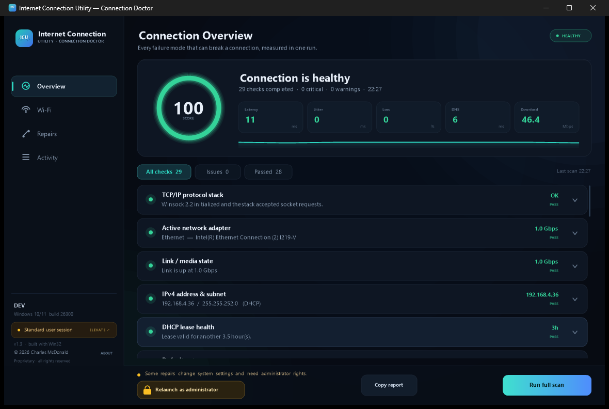
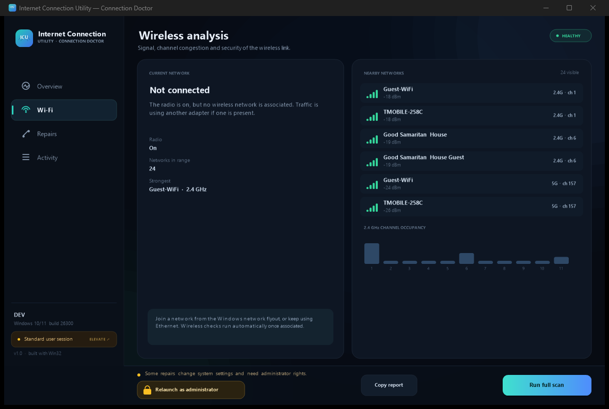
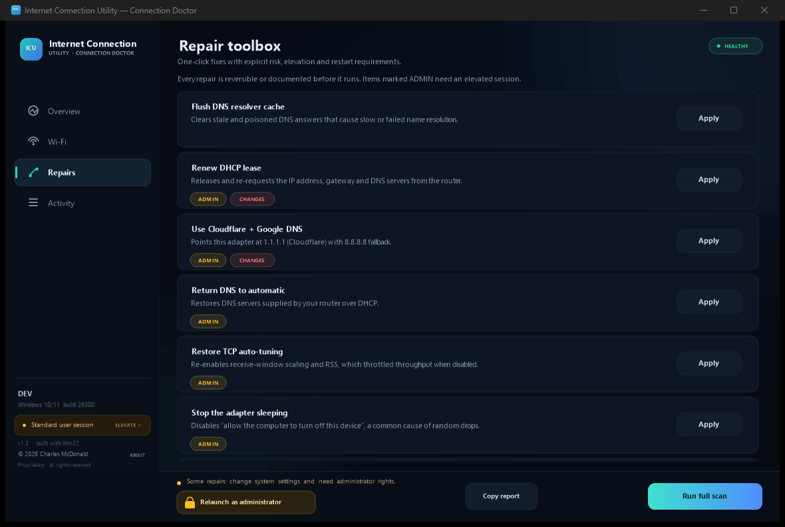
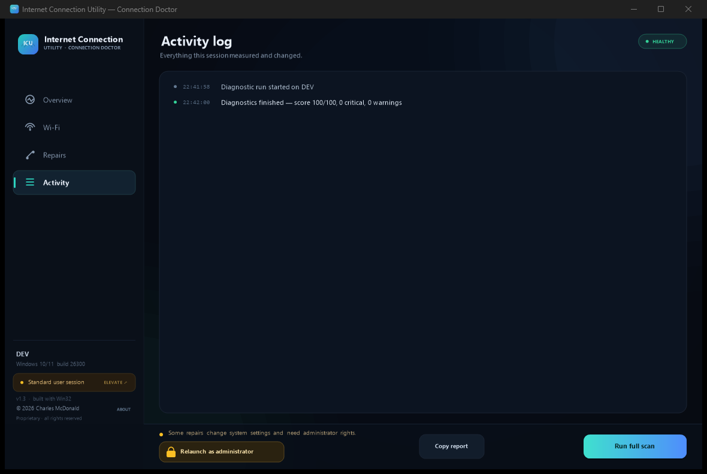
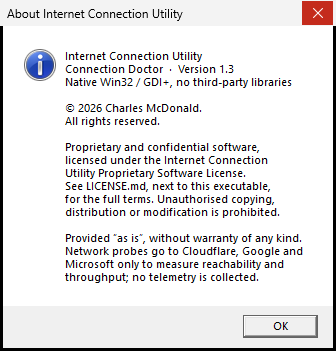

# Internet Connection Utility — Connection Doctor

Part of [Zanphar's WinSuite](../README.md). A self-contained Windows utility that finds out why a
connection is failing, dropping, or performing badly — and repairs it. One native C++ executable,
no installer, no runtime, no third-party libraries.

Internet Connection Utility measures the things that actually break connections: packet loss,
jitter, DNS resolution, the first hop, path MTU, TLS egress, Wi-Fi signal and channel congestion,
plus the Windows settings that silently throttle or suspend a network adapter. Every finding is
scored, explained in plain English, and paired with a one-click repair where one exists.

## Screenshots

**Overview** — overall score, headline metrics and the check list, which fills in as each probe
completes:



**Wi-Fi** — the current network, nearby networks with band and channel, and 2.4 GHz channel
occupancy:



**Repairs** — the repair toolbox, each entry labelled with the risk it carries (`ADMIN`,
`CHANGES`, `RESTART`):



**Activity** — everything the session measured and changed, timestamped:



## What it checks

| Area | Checks |
| --- | --- |
| Protocol stack | Winsock initialization, TCP/IP stack health |
| Adapter & link | Adapter presence, media/link state, negotiated speed, driver provider and age |
| Addressing | IPv4 address and subnet, APIPA self-assignment, DHCP lease, duplicate addresses |
| Routing | Default gateway present and reachable, default-route count and interface metric, VPN/virtual capture |
| Interface health | Receive/transmit errors and discards |
| DNS | Configured resolvers, per-server UDP probe with latency, name resolution, hosts-file hijacking |
| Internet | ICMP latency, jitter and loss, TCP :443 handshake, HTTPS egress, captive portal, download throughput, TCP retransmission rate |
| Path | Path MTU / fragmentation probe |
| Windows tuning | TCP receive-window auto-tuning, NIC power management, firewall profiles, core network services, user proxy and PAC |
| Wi-Fi | Radio and association, signal strength/RSSI, band and channel, neighbour scan, 2.4 GHz channel occupancy, security (open/WEP), power saving |

The scan streams results into the interface as each check completes, then produces a 0–100 score.
Roughly 30 checks run; the exact count adapts to the hardware present (for example, signal and
channel checks only run when a wireless network is associated).

## What it repairs

Nineteen repairs are available, each labelled `ADMIN`, `RESTART`, or `CHANGES`:

- Flush the DNS resolver cache, re-register DNS, renew the DHCP lease
- Point the adapter at Cloudflare/Google DNS, or return DNS to DHCP
- Reset the Winsock catalog, reset the TCP/IP stack, restore TCP auto-tuning
- Disable the user proxy or reset the WinHTTP proxy
- Stop the adapter from powering down; set the Wi-Fi power plan to maximum performance
- Reset the interface metric, match the adapter MTU to the measured path
- Enable or restart the adapter, reconnect Wi-Fi
- Start stopped network services, restore the hosts file

Risky repairs ask for confirmation. Repairs needing elevation offer to relaunch the app as
administrator. Everything applied is written to the Activity log with a timestamp, and the scan
re-runs automatically afterwards.

## Requirements

- Windows 10 or Windows 11, x64
- No runtime, redistributable, or network service required
- Administrator rights are optional — only some repairs need them

## Build

The suite build compiles it with the other programs:

```bat
build_all.bat
```

The executable lands in `bin\\InternetConnectionUtility.exe`. To build just this program:

```bat
InternetConnectionUtility\\build_mingw.bat
```

Both use `g++` and `windres` from MinGW-w64 (or `MINGW_BIN`) and link statically; the result
depends only on DLLs Windows itself provides. Resources are compiled in `%TEMP%` because the suite
folder name contains an apostrophe and a space.

## Using it

1. Run `bin\\InternetConnectionUtility.exe`. A full scan starts automatically; press `F5` to run it again.
2. The **Overview** tab shows the score, headline metrics (latency, jitter, loss, DNS,
   download), and every finding. Click a row to expand the explanation, remediation steps and
   any repair button. Filter with **All checks / Issues / Passed**.
3. **Wi-Fi** shows the current network, nearby networks with signal and channel, and channel
   occupancy — useful for diagnosing interference-driven dropouts.
4. **Repairs** lists every action with its risk level; **Activity** is the audit log.
5. If the footer shows a standard-user session, use **Relaunch as administrator** (or the
   `ELEVATE` pill in the sidebar) to unlock repairs that change system settings.
6. **Copy report** copies a plain-text summary of all findings to the clipboard.

## How the repairs are applied

Repairs use documented Windows interfaces only: `ipconfig`, `netsh`, `powercfg`, the Service
Control Manager, IP Helper (`SetIpInterfaceEntry`), and specific registry values. Nothing is
downloaded, nothing is installed, and no telemetry is sent. Network probes go to Cloudflare,
Google and Microsoft endpoints solely to measure reachability and throughput.

Disk defragmentation and TRIM are not part of this program; they live on the suite's **Storage**
page, where the volume, its media type and the result stay together.

## Project layout

```text
InternetConnectionUtility\\
├─ src\\
│  ├─ main.cpp      wWinMain entry point
│  ├─ ui.cpp/.h     GDI+ interface, layout, interaction
│  ├─ doctor.cpp/.h Diagnostic engine, scoring and repair catalogue
│  └─ net.cpp/.h    ICMP, DNS, WinHTTP, WLAN, IP Helper, registry, process helpers
├─ res\\
│  ├─ app.rc        manifest, icon and version information
│  ├─ app.manifest  asInvoker, PerMonitorV2
│  ├─ app.ico       multi-size icon (16–256 px)
│  ├─ icon-preview.png
│  └─ resource.h    resource identifiers
├─ tools\\
│  └─ make_icon.ps1 regenerates res/app.ico with GDI+
├─ docs\\            screenshots used above
├─ build_mingw.bat  MinGW build for this program only
└─ README.md
```

## Known limitations

- IPv6 DNS servers are validated through the system resolver rather than probed directly
  (the built-in probe is IPv4-only).
- The path-MTU probe depends on ICMP; it is skipped when ICMP is filtered.
- Throughput is a short single-stream sample, not a calibrated speed test.
- Winsock and TCP/IP resets require a restart before they take full effect.

## License

BSD 3-Clause — see [../LICENSE.md](../LICENSE.md), copyright 2026-2027 Charles McDonald.

The sidebar footer shows the product name; clicking it opens the About panel, which repeats the
version and copyright:


