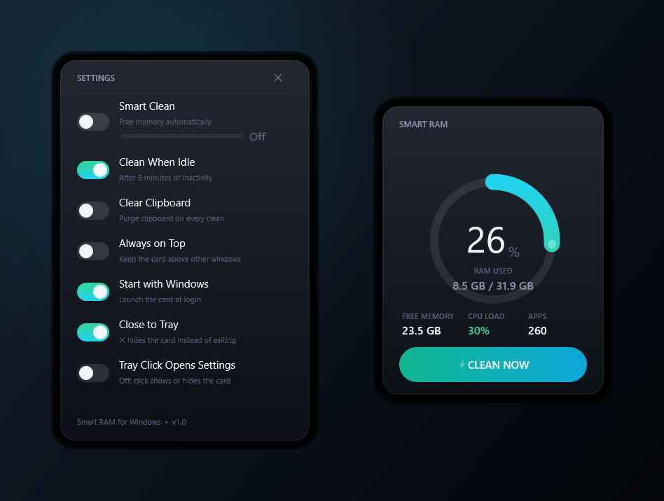

# Smart RAM (Modern)

A from-scratch, modern re-implementation of IObit Advanced SystemCare's
`Suo10_SmartRAM.exe` — the floating "Monitor and release memory" widget —
written in plain C++/Win32 with Direct2D/DirectWrite. **Zero external
dependencies** (no runtime DLLs, no third-party libraries, static CRT).



## What it does

- **Floating monitor card** — animated RAM gauge (colour shifts cyan → red
  as pressure rises), RAM used / total, free memory, CPU load and running
  process count, updated twice a second.
- **Clean now** — instantly purges the Windows standby list and trims every
  running process's working set (`NtSetSystemInformation(SystemMemoryListInformation,
  4/5)` + `EnumProcesses`/`EmptyWorkingSet`), then reports the result on the
  card itself: a line under the button reads `1.24 GB FREED` (or
  `NOTHING TO FREE`) and stays there until the next clean. That line is the
  only feedback — no toast and no tray balloon, so a clean never steals focus
  or covers another window.
- **Deep Memory Clean** — an optional aggressive clean: alongside the normal
  standby-list purge and working-set trim it also flushes the modified page
  list, empties the system working set, and trims the system file cache, so
  cached and unused pages are handed back to the free list. Enable it in
  Settings or from the tray menu's **Deep memory clean** toggle; every clean
  (manual, Smart Clean, idle) then runs the deep passes and the card reports
  `DEEP • … FREED`.
- **Tray icon** — *animated*: the mini-gauge eases in step with the card
  gauge (~12 fps while the value is moving), the colour flows green → amber
  → red continuously, and it switches to a spinning progress ring while a
  clean is running. Tooltip shows RAM %/CPU %. A single left-click opens or
  closes the card; a double-click opens or closes the settings card;
  right-click opens the menu.
- **Smart Clean** — automatically cleans when RAM usage crosses a
  configurable threshold (50–95%, with a slider).
- **Clean When Idle** — cleans after 5 minutes of keyboard/mouse inactivity.
- **Clear Clipboard** — wipes the clipboard on every clean.
- **Always on Top**, **Start with Windows** (HKCU Run key).
- All settings persist to a plain INI at
  `%LOCALAPPDATA%\SmartRAM\config.ini`; the widget remembers where you left
  it after dragging (with per-monitor bounds checking).
- Single-instance guard — launching the exe again nudges/surfaces the
  existing widget.

## Building

The app is a single `.exe` at runtime. Two toolchains are supported; neither
build needs any SmartRAM DLLs or redistributables next to the executable.

### Visual Studio / MSVC (default)

Requirements: Visual Studio (MSVC, x64) + CMake + Ninja (all bundled with
Modern VS / "Desktop development with C++").

```powershell
powershell -ExecutionPolicy Bypass -File tools\build.ps1
.\build\SmartRAM.exe
```

`tools/build.ps1` imports `vcvars64.bat`, runs CMake (Ninja generator) and
produces a single static, self-contained `SmartRAM.exe` (static CRT; only
Windows system DLLs remain as dependencies).

### MinGW-w64 (no Visual Studio)

Requirements on `PATH`: MinGW-w64 (x86_64), CMake and Ninja. WinLibs is one
self-contained way to get the toolchain.

```powershell
powershell -ExecutionPolicy Bypass -File tools\build-mingw.ps1
.\build-mingw\SmartRAM.exe
```

The MinGW build links the GCC runtime (`libgcc`, `libstdc++`, winpthread)
statically and still produces one `.exe`. It targets Windows 10/11 and uses
the Universal CRT that ships with Windows. Both executables are single files;
the MSVC build has the smallest dependency list.

### Packaging

```powershell
powershell -ExecutionPolicy Bypass -File tools\package.ps1
# or, to package the MSVC build:
powershell -ExecutionPolicy Bypass -File tools\package.ps1 -Toolchain MSVC
```

Builds the selected toolchain and writes
`dist\SmartRAM-<version>-win64.zip`, containing `SmartRAM.exe` and
`README.md`, plus a matching `.sha256` file. The version is read from
`res/app.rc`. The default is the MinGW build.

## Design / implementation notes

- **Per-pixel-alpha layered windows** (`WS_EX_LAYERED` +
  `UpdateLayeredWindow`) with a D2D *DC render target* bound to a top-down
  premultiplied DIB — true rounded-corner glass cards with a hand-drawn
  multi-pass shadow (layered windows get no DWM shadow).
- **Everything is drawn**: gauge arcs with gradient strokes and glow pass,
  springy "EaseOutBack" intro pop, toggle switches, hover chrome that fades
  on mouse-over, press-down button scale animation, clean spinner.
- All DPI aware (PerMonitorV2 manifest), scale-aware layout, drag-
  constrained to the virtual desktop.
- CPU % from `GetSystemTimes` deltas; process count from
  `GetPerformanceInfo`; memory stats from `GlobalMemoryStatusEx`.
- Modules: `layerwin` (window base), `widget` (main card), `settings_win`
  (settings card), `gfx` (D2D kit), `cleaner`, `metrics`, `settings` (INI),
  `tray`, `app`.
